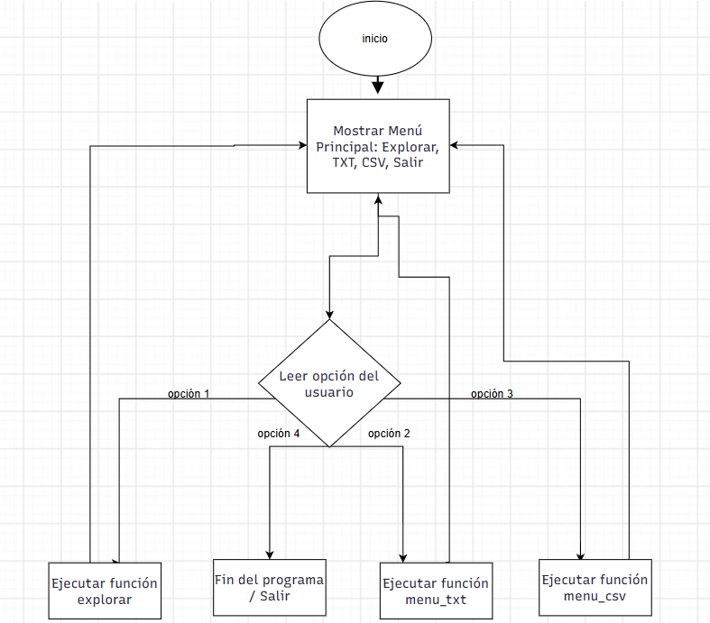
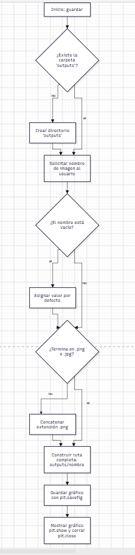
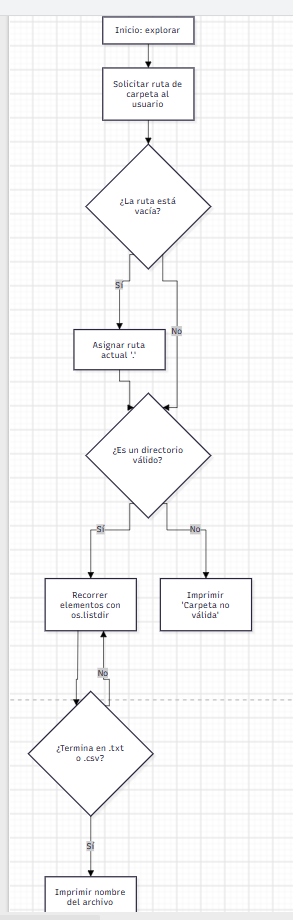
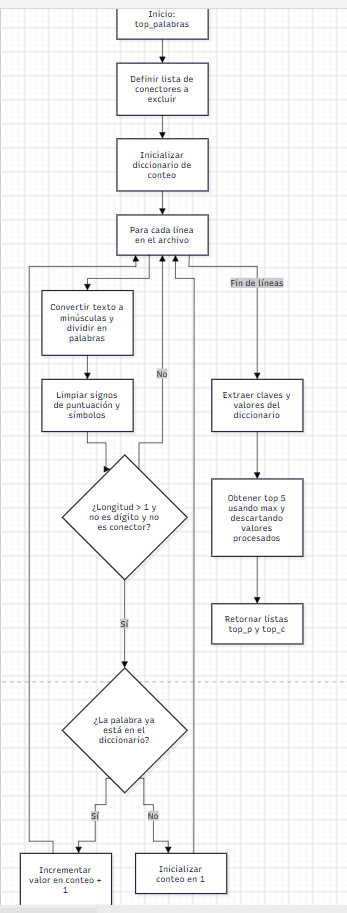
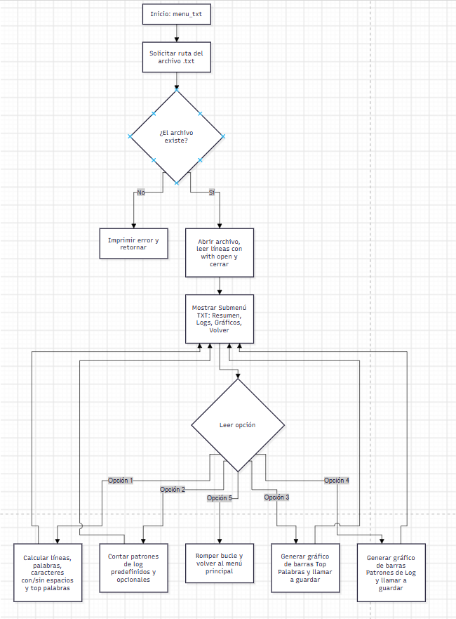
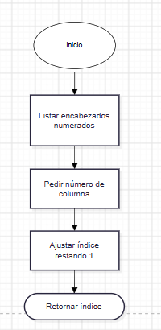
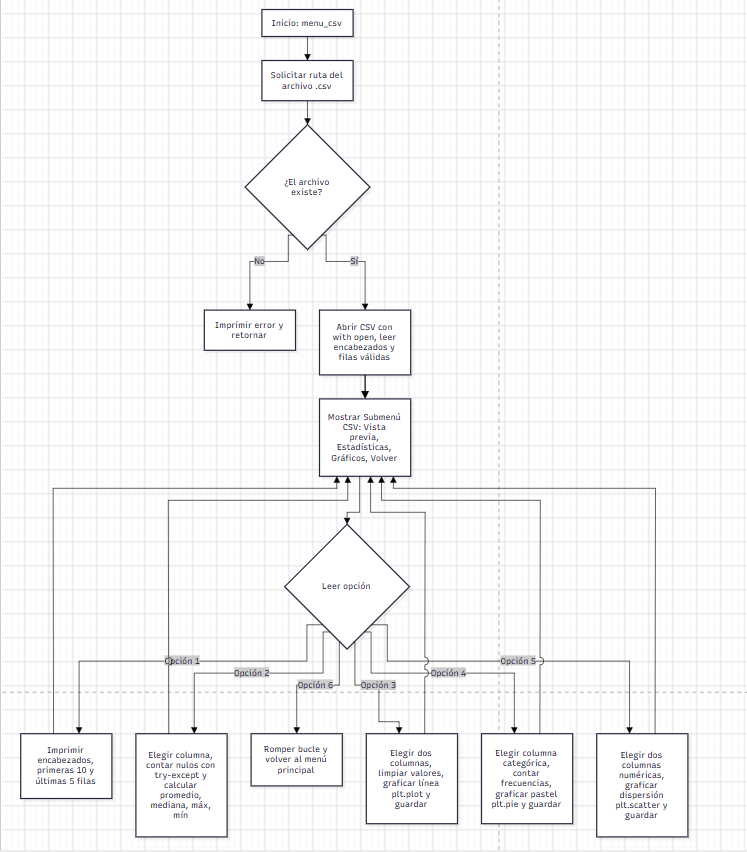

### trabajo programacion reto 5
## diagrama de flujo menu principal 

## diagrama de flujo de funciones 

# funcion guardado

# funcion explorar

# funcion analisis texto

# funcion menu TXT

# funcion encabezados

# funcion CSV

